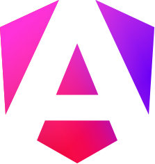

<p align="center"></p>

# angular-steps

Cucumber step definitions for Angular apps, for [webship-js](https://webship.co/docs/webship-js/2.0.x), a BDD browser
automation harness built on Playwright and Cucumber-js.

An Angular page drawn on the server arrives as HTML; the app's scripts then take it over in the browser (hydration).
Until they have, a link loads a whole page and a form posts to the server. After that, the router changes views inside
the page, a view's data comes from its resolver before the address changes or from the view after it, a form is sent
in place, and the app shows its own page for an error. The steps wait for each of those to end, on signals a
production page shows, never for a fixed time:

- the app taking the page over: the early event contract Angular clears once the app is stable (`window._ejsas`), or
  the hydration data it removes (`ngh`) and the server's styles it takes over; for a page drawn in the browser, the
  root it bootstraps (`ng-version`);
- the router's navigations: each one commits the address with its `navigationId` in the history state;
- the document: a change of view keeps it, a whole page load brings a new one (told apart without counting on a
  request);
- the requests in flight (a resolver's, a view's data, a form sent in place), the frames asked for and the
  animations running.

Angular's debugging globals (`ng`, testability) are not there in a production build, and a new app has no Zone to
ask: the steps need none of them.

The same steps run in a browser with JavaScript and in one without: a form's step waits for the answer of the request
the app sends in place in the one, and for the page the posted form loads in the other.

No step phrase names the framework: a scenario reads `When I navigate with the "Posts" link`, `When I send the form by
its "Send" button` and `Then the form should have been refused with "…"`.

CI makes the demo (Angular's official starter with server rendering and the pages of [`demo/`](demo/)), builds it,
serves it with its own server, and runs the whole suite against it twice in a browser with JavaScript and twice in one
without, then the assertions that must fail in each; see [`.github/workflows/test.yml`](.github/workflows/test.yml).

## Taking the page over

A page with Angular is waited on until the app has taken it over. For a page drawn on the server that is the early
event contract cleared (a new app has event replay: Angular clears the contract once the app is stable), or, in an app
without event replay, no hydration data left (`ngh`) and the server's styles taken over (`style[ng-app-id]`). For a
page drawn in the browser, it is the root bootstrapped (it gets `ng-version`). Every step that acts (navigating with a
link, sending a form) waits for it first; `Given the page is hydrated` waits for it on purpose. A page without Angular,
and every page in a browser without JavaScript, have nothing to wait for: the steps go on, and say so in the run's log.

A route Angular renders in the browser alone (`renderMode: RenderMode.Client` in the server routes) arrives as the
app's empty element, its body marked `ngcm`, and so does every page of an app without server rendering (its plain
`index.html`, served by a static server): `Then the page should have been rendered in the browser alone` says so, and
without JavaScript such a page stays empty.

## From nothing to a green run

What the machine needs: git, Node.js 24 or later with npm, and Docker to make and serve the demo (or an Angular app
that is built and served already).

**1. An app.** Any Angular app works (step 5 points the suite at it). To start, make the demo with this repository's
script: it runs the Angular CLI (`ng new --ssr`), puts the pages of `demo/` over the starter, and builds it, in a
Node.js container; then serve it with its own server:

```bash
git clone https://github.com/webship/angular-steps.git
cd angular-steps
npm run demo:build
npm run demo:serve
```

The demo answers at `http://127.0.0.1:3000`: a home page with a counter, an about page, posts loaded from the demo's
API, a contact form, and a page rendered in the browser alone. Leave the server running in its own terminal. It has
no accounts: the steps need none.

**2. A test project**, in another folder:

```bash
mkdir angular-tests && cd angular-tests
npm init -y
npm install --save-dev webship-js @webship-js/angular-steps
npx init-webship-js
```

`npx init-webship-js` writes `cucumber.js`, `playwright.config.ts`, the `tests/` folders with a first feature and the
`npm test` scripts, and installs Chromium.

**3. `cucumber.js`.** Replace the file with the wiring of the pack: the step files of webship-js and of the pack, the
tags that keep the lanes of this repository out of a normal run, and the address of the app.

```javascript
module.exports = {
  default: {
    requireModule: ['tsx/cjs'],
    require: [
      'node_modules/webship-js/tests/step-definitions/**/*.js',
      'node_modules/@webship-js/angular-steps/tests/step-definitions/*.js',
      'tests/step-definitions/**/*.js',
    ],
    paths: ['tests/features/**/*.feature'],
    // Work in progress, the assertions that must fail and the scenarios of a browser without JavaScript stay out.
    tags: 'not @wip and not @must-fail and not @no-javascript',
    format: ['@cucumber/pretty-formatter', 'json:tests/reports/cucumber_report.json'],
    worldParameters: {
      launchUrl: process.env.LAUNCH_URL || 'http://127.0.0.1:3000',
      // Browser errors are reported, not failed: a form refused shows one ("Failed to load resource: 422").
      javascript: { mode: 'warn', levels: ['error'] },
      // The waits webship-js adds around each page, scenario and step (milliseconds).
      minWaitTime: { page: 3000, before_scenario: 0, after_scenario: 0, before_step: 0, after_step: 0 },
    },
  },
};
```

**4. A first feature**, `tests/features/first-run.feature`:

```gherkin
Feature: First run
  Scenario: A link changes the view by the router
    Given I am on "/"
    When I navigate with the "Posts" link
    Then the router should have changed the view
    And the view's title should be "Posts"

  Scenario: A message too short is refused
    Given I am on "/contact"
    And the page is hydrated
    When I fill in "Your name" with "Ada"
    And I fill in "Your message" with "Too short"
    And I send the form by its "Send" button
    Then the form should have been refused with "Your message needs at least 10 characters."
```

**5. Run it.** Set `LAUNCH_URL` to the address of the app:

```bash
LAUNCH_URL=http://127.0.0.1:3000 npm test
```

A green first run prints every step, the browser error of the refused message (reported, not failed:
`mode: 'warn'`), then the summary (the starter feature of `npx init-webship-js` and the two scenarios above, passed)
and the HTML report it wrote:

```
[webship-js] JavaScript errors during "A message too short is refused" (mode=warn):
  1. [console.error] Failed to load resource: the server responded with a status of 422 (Unprocessable Entity)

3 scenarios (3 passed)
12 steps (12 passed)
0m03.230s (executing steps: 0m03.195s)
[webship-js] HTML report → …/angular-tests/tests/reports/cucumber_report.html
```

From there, copy the features of [`tests/features/`](tests/features/) (they also ship in the package, under
`node_modules/@webship-js/angular-steps/tests/features/`): together they use every step of the pack, against the demo.

### On an app of your own

Point `LAUNCH_URL` at the address the app is served at, and write the features from what its pages show: links and
buttons by the names a person reads, forms by their buttons, views by their titles and addresses.

- **Fill in fields once the page is hydrated** (`And the page is hydrated` after `Given I am on "…"`): when the app
  takes the page over, its form writes its own values into its fields, and what was typed before is lost.
- **A browser without JavaScript:** set `javaScriptEnabled: false` in `contextOptions` of `playwright.config.ts`
  (this repository does it from `JAVASCRIPT=off`) and run the scenarios that hold without it. The same steps wait for
  whole page loads there.
- **webship-js's own steps** (`I press "…"`, `I click "…"`) do not wait for the app. Tag a scenario
  `@idle-after-steps`, and after each of its steps the pack waits for the app to be idle, on a page with Angular; or
  follow such a step with `When I wait for the app to be idle`.
- **The link of the current view** is the one with `aria-current="page"`: give a `routerLinkActive` link
  `ariaCurrentWhenActive="page"`, or the step `the "…" link should be the active one` finds none.
- **An address Angular's server answers.** A server-rendered app answers only the hosts it is told about
  (`NG_ALLOWED_HOSTS` or `allowedHosts`), with a 400 for any other: run the suite against one of them.

### What the suite tests

The features of this repository run every step of the pack against the demo, in CI on every change, in a browser with
JavaScript and in one without:

- the app taking the page over, a page rendered in the browser alone, and a count that changes in place;
- views: a link that changes the view by the router, the view's title, the link of the current view, the address, a
  view whose data a resolver fetches and the browser's back, data loaded again, a link whose view a guard redirects,
  and the whole pages a browser without JavaScript loads;
- the contact form: a message accepted, one refused with its message, answered in place with JavaScript and with a
  whole page without it;
- the pages of a missing post (loaded, and reached inside the app) and of an address the app does not know.

Not tested: lazy-loaded routes, deferred blocks (`@defer`) and their incremental hydration, i18n, and the development
server.

## Requirements

- Node.js 24 or later
- A webship-js 2.0 test project, webship-js 2.0.18 or later
- An Angular app, built and served (proven on Angular 22.3 with server rendering, zoneless, and on a route rendered in
  the browser alone; and on an app of Angular 20.3 without server rendering, served by a static server)

## Install

```bash
npm install --save-dev @webship-js/angular-steps
```

## Quick start

1. Add the step files to the `require` list of your webship-js `cucumber.js`, after webship-js's own:

   ```javascript
   require: [
     'node_modules/webship-js/tests/step-definitions/**/*.js',
     'node_modules/@webship-js/angular-steps/tests/step-definitions/*.js',
     'tests/step-definitions/**/*.js',
   ],
   ```

2. Point `launchUrl` at the app:

   ```javascript
   worldParameters: {
     launchUrl: process.env.LAUNCH_URL || 'https://app.example.com',
   },
   ```

3. Write a feature from what the app shows:

```gherkin
Feature: Signing in
  Scenario: A wrong password is refused
    Given I am on "/login"
    And the page is hydrated
    When I fill in "Email" with "ada@example.com"
    And I fill in "Password" with "wrong"
    And I send the form by its "Log in" button
    Then the form should have been refused with "Wrong email or password"
```

Run `npx cucumber-js --dry-run` once: it reports any undefined or ambiguous step before a browser opens.

## Test users

None. The demo has no sign-in, and the steps need no account (an app's own sign-in form is sent with the steps of the
pack, like any other form). `cucumber.js` lists no accounts and no scenario signs in:

```json
{}
```

## What is included

| File | Steps | Covers |
| --- | --- | --- |
| `angular-page.steps.js` | 4 | The app taking the page over (waited for, or asserted), a page rendered in the browser alone, and the wait for the app to be idle; the opt-in `@idle-after-steps`. |
| `angular-views.steps.js` | 7 | A link navigated with and the browser's back, each to its end; how the last navigation ended (by the router, or a whole page); the view's title; the link of the current view; the address; the wait for the app's requests. |
| `angular-forms.steps.js` | 4 | A form sent by a button, in either mode; whether it was accepted, or refused and why; how it was answered. |
| `angular-errors.steps.js` | 1 | The app's page for a status: the status of a page loaded, or the code a view reached inside the app shows; its message. |
| `angular-helpers.js` | | Shared plumbing for the files above and for your own steps: the wait budgets, the poll on the page, the app taking the page over, the app being idle, following a navigation to its end, finding a link or a button by its name, the failure messages (which name the lane without JavaScript). It registers no step. |
| `angular-probe.js` | | The page side: put into every page before its own scripts, it keeps an id for each document, the frames the page asks for, its requests in flight, its inputs and changes, whether the server's HTML held the page, and the router's commits of the address. It registers no step. |
| `demo/` | | The pages of the demo app (MIT, this pack's own), put over Angular's starter by `.github/scripts/build-demo.sh`; the Webship Workspace's plugin builds the same demo from them. |

webship-js's own steps still go to an address (`Given I am on "/posts"`), read the page (`I should see "…"`), fill in
fields and press keys: this pack adds the app's own views, its forms and their waits.

## How the steps find things and wait

- **By the name a person reads.** A link or a button by its accessible name (its text, or its label), as Playwright
  computes it: exactly, then without regard to case, then by its start (three characters or more); never a part in
  the middle. A form's button among the buttons of the page's forms.
- **Hydrated first.** Every step that acts waits for the app to take the page over, when the page has Angular and the
  browser runs JavaScript.
- **A navigation to its end, never by a request.** By the router: it has committed the address (`navigationId` in the
  history state changed) and the app is idle. A whole page: a new document has loaded and, when it can be, been taken
  over. A link to the address already shown starts no navigation; one the router commits nothing for (a guard said
  no) ends with the app idle and no commit for half a second, and `the router should have changed the view` then says
  it went nowhere.
- **A form in either mode.** After the click, whichever comes first: the request the app sends in place (its answer,
  then the app idle), or a page load (through the server's redirects). A button the app handles in the page, sending
  nothing, ends when the app is idle. A form was accepted when its answer is not a refusal and the page shows no
  alert; it was refused when its answer is a 4xx or the page shows an alert (`role="alert"`).
- **Idle:** no page load, the page taken over when it can be, no request in flight, no frame asked for, no finite
  animation running, and 40 ms of quiet with a frame after the last input (or 100 ms of nothing).
- **Then steps wait for what they expect,** up to the step's budget (`minWaitTime.page`, at least 10 seconds), looking
  every 50 milliseconds from Node.js (a poll by frames would keep a page that counts its frames from ever being idle).
- **Failures say what was found,** and a failure in a browser without JavaScript says so: `Expected the page to be
  hydrated, but the browser has JavaScript off.`

### Notes on waits

What the app does that a test must wait past, found by recording it in a real browser:

- **Taken over within a frame of the load.** On the demo the hydration data is gone and the router's first navigation
  committed when the page has loaded (about 40 ms), and the early event contract is cleared in the next frame.
- **Before then, a link loads a whole page.** Event replay replays a button's click once the app is stable, but not a
  link's: the browser follows the link. A form sent before then is posted to the server.
- **Fields typed before then are lost** (see the findings): the steps wait, and a scenario fills in fields after
  `And the page is hydrated`.
- **The address first, then the view, then the title.** The router commits the address (`pushState`) after its guards
  and resolvers, just before it activates the new view; the title follows within a few milliseconds.
- **A view's data before or after the address.** A resolver's request runs before the address changes; a view that
  fetches its own data (`httpResource`) asks for it once it is shown. Either way the steps wait for it.
- **A guard's redirect skips a number.** The cancelled navigation commits nothing; the next commits the address the
  guard sent to, with a `navigationId` one higher than the cancelled one's.
- **The browser's back** is a `popstate`, then the router's `replaceState` with a new `navigationId`.
- **The focus stays where it was.** After a change of view the focus stays on the link that was clicked, or goes to the
  page when that link is gone: the app does not move it.

### Findings

Found while writing the steps; not reported upstream yet (the owner decides).

- **A change of view is silent to a screen reader.** Angular has no route announcer: the router changes the title, and
  nothing tells a screen reader of the new view unless the app does (a live region of its own, or the CDK's
  `LiveAnnouncer`). The steps check the view's title (`the view's title should be "…"`); they cannot check that a
  screen reader was told.
- **Fields typed before hydration are lost.** The early event contract captures the fields' `input` events, but when
  the app takes the page over, its form writes its own (empty) values into the fields, and the replayed events read
  the cleared fields. On the demo, a name and a message typed before then were sent empty, and the form was refused
  with "Your name is required.".

## Steps

One example of each step; the JSDoc block above each definition holds five.

### `angular-page.steps.js` (4)

- `Given the page is hydrated`
- `Then the page should be hydrated`
- `Then the page should have been rendered in the browser alone`
- `When I wait for the app to be idle`

### `angular-views.steps.js` (7)

- `When I navigate with the "Posts" link`
- `When I go back one view`
- `Then the router should have changed the view`
- `Then the view's title should be "Posts"`
- `Then the "Posts" link should be the active one`
- `Then the app's address should be "/posts"`
- `When I wait for the app's requests to finish`

### `angular-forms.steps.js` (4)

- `When I send the form by its "Send" button`
- `Then the form should have been accepted`
- `Then the form should have been refused with "Your message needs at least 10 characters."`
- `Then the form should have been answered in place`

### `angular-errors.steps.js` (1)

- `Then the app should show its 404 page`

## Phrases shared with other packs

None of this pack's phrases matches one of webship-js (`npm run test:examples` checks it), nor one of the 58 step packs
published so far, and none of their 23,147 examples matches one of this pack's steps. The Svelte, Vue, Flutter and
Next.js packs speak of the same things in words of their own ("go back in the app", "wait for the app to settle",
"use the … link"), so the pack loads beside any of them.

## Angular's own tests and this pack

Angular's own server-rendering suite (`integration/platform-server` of angular/angular, MIT) drives its test apps with
Selenium WebDriver. Its test app does not boot by itself: each spec calls `doBootstrap()`, so the suite chooses when
the client starts, where a test of a real app has to find out (which is what this pack does). Its specs, and the
features that cover the same ground on a real app:

| Angular's own suite | In this pack |
| --- | --- |
| `helloworld`: the server's content stays the same when the client boots; the server's styles are taken over | `page.feature`: a page drawn on the server, taken over, with its text; the styles are one of the signals the steps read |
| `transferstate`, `http-transferstate`: the client reuses what the server fetched | `views.feature`: the posts drawn on the server and shown once the app has taken the page over; the steps do not count requests |
| `defer`: a deferred block that is never hydrated | not in this pack |
| every spec: no browser error | the suite fails on any browser error, except where a scenario expects a 4xx answer (`@js-warn`, said in a comment) |

Not in this pack: lazy-loaded routes, deferred blocks and their incremental hydration, i18n, and the development
server.

## Testing this package

```bash
npm install
npm run demo:build         # the demo: Angular's starter and the pages of demo/, made and built in a Node.js container, in demo-app/
npm run demo:serve &       # served at http://127.0.0.1:3000
npm run test:examples      # the examples and the features against the step patterns
npm run test:paths         # a feature or a scenario named on the command line runs alone
npx cucumber-js --dry-run  # no undefined and no ambiguous step
LAUNCH_URL=http://127.0.0.1:3000 npm test                 # the suite, with JavaScript
LAUNCH_URL=http://127.0.0.1:3000 npm run test:must-fail   # assertions that must fail, each with its message
```

The lane without JavaScript:

```bash
JAVASCRIPT=off CUCUMBER_TAGS='not @wip and not @must-fail and not @needs-javascript' LAUNCH_URL=http://127.0.0.1:3000 npm test
JAVASCRIPT=off MUST_FAIL_TAGS='@must-fail and not @needs-javascript' LAUNCH_URL=http://127.0.0.1:3000 npm run test:must-fail
```

The tags: `@needs-javascript` runs only with JavaScript, `@no-javascript` only without (not `@javascript`, which
webship-js reads as "fail the scenario on any browser error"). In CI each lane names its reports
(`cucumber_report-javascript-off.json`, `must-fail-javascript-off.json`), so a failure of one is never read as the
other's.

This repository's own suite fails a scenario on any browser error (`javascript.mode: 'fail'` in `cucumber.js`). The
browser logs a 4xx answer as a console error ("Failed to load resource"), so the scenarios that expect one (a form
refused, a page that is not there) are tagged `@js-warn`, each with a comment that says why.

`tests/must-fail/` holds scenarios that assert something that is not true of the demo. `npm run test:must-fail` runs
them and checks that each one fails at its last step, with the message it announces and a hint: a step that cannot
fail proves nothing. It runs them with a wait of 3 seconds (`COMPONENT_WAIT_MS`), since each of them waits its whole
budget.

`LAUNCH_URL` points the suite at another address; `npx cucumber-js tests/features/forms.feature` runs one feature;
`FEATURES` runs a subset too; `CUCUMBER_TAGS=@critical` runs the smoke lane; `HEADLESS=false` shows the browser.

The suite leaves the demo as it found it: the demo keeps nothing (the contact form only answers).

## The demo

The demo is made, not kept as a whole in this repository. [`.github/scripts/build-demo.sh`](.github/scripts/build-demo.sh)
runs the Angular CLI, `ng new --ssr` (Angular CLI 22.3.0), puts the pages of [`demo/`](demo/) over the starter, and runs
`npm install` and `npm run build`, in a Node.js 24 container pinned by its digest, into `demo-app/`;
[`.github/scripts/serve-demo.sh`](.github/scripts/serve-demo.sh) serves the build with its own server
(`node dist/demo/server/server.mjs`), telling it the hosts it answers (`NG_ALLOWED_HOSTS`, 127.0.0.1 and localhost).

- The starter is Angular's own, generated by the Angular CLI (MIT, https://github.com/angular/angular-cli): it is made
  at each build, and nothing of it is in this repository except `demo/src/server.ts`, the demo's server, written over
  the starter's.
- The pages of `demo/` are this pack's own (MIT): a home page with a counter, an about page, posts from the demo's API
  (`httpResource`), a post by a resolver (404 for a missing one, and a link to one that was taken down), a guard that
  sends `/posts/latest` on to the latest post, a contact form that works without JavaScript and is sent in place with
  it, a page rendered in the browser alone (`RenderMode.Client`), and a 404 page for an address it does not know.
- On the server, the demo's requests to its own API go to its own port, never to the address the browser used (which
  a server in a container may not reach): an interceptor of the demo's own (`demo/src/app/app.config.ts`).
- Angular's own suites and sources (MIT) were read, to learn what the framework does that a test must wait for;
  nothing of them is in this repository.

## How the steps were written

Everything a step relies on was seen in a real browser first, on the built demo: when the app takes a page over and
what it changes then, what a click before then does, what a change of view and a whole page load each change, when
the router commits the address and when the title follows, the requests of a view, of a resolver and of a form with
JavaScript and without, where the keyboard focus goes. The steps were written from that, and are proven on Angular
22.3 (zoneless, server rendering, incremental hydration), in English, with Chromium, with JavaScript and without.

## License

MIT (see `LICENSE`).

## Logo

The Angular logo is the Angular team's, from github.com/angular/angular, under CC BY 4.0
(https://creativecommons.org/licenses/by/4.0/), as Angular's press kit provides it. It is not covered by this
package's MIT licence.
